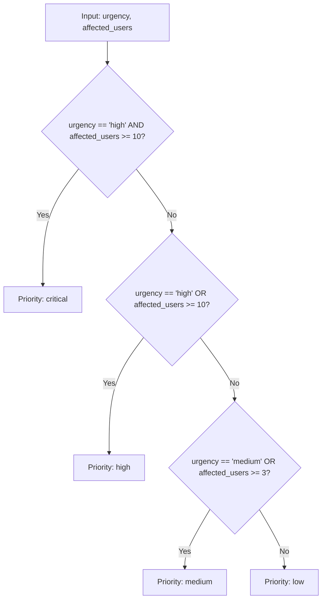
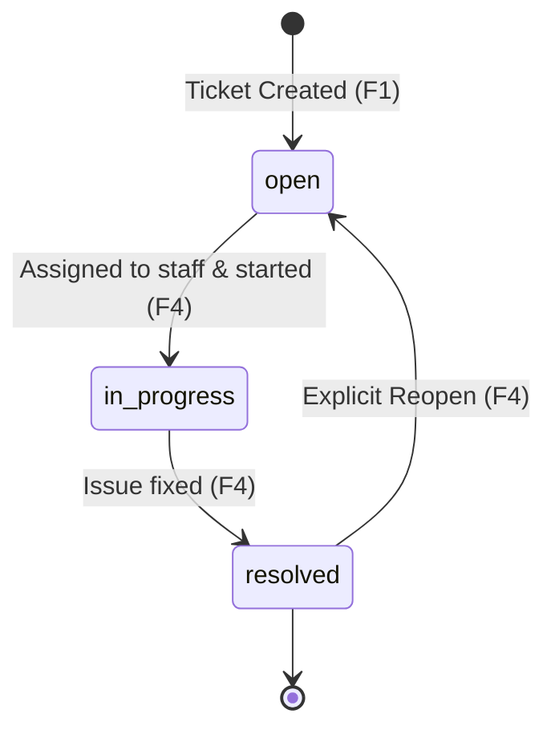

README.md — Engineer A's Section
Here's a straight, honest README focused on your (Engineer A) contribution. You can either use this as-is or merge it into a shared README with your partner.

Engineer A: Elizabeth Odeh
Engineer B: Agbaji Alexander

# CampusFlow

A Python command-line ticket manager for Learn2Earn campus staff. It records
technical support requests (Wi-Fi outages, faulty laptops, broken dev
environments, inaccessible platforms), calculates priority, assigns
responsibility, and tracks progress.

## Problem

Campus staff report issues informally — through WhatsApp, hallway chats, email —
and those reports get lost. CampusFlow gives every request a tracked record
with a computed priority and a clear owner.

## Team

- **Engineer A** — Ticket creation, input validation, priority engine, tests
- **Engineer B** — Assignment, workflow state machine, work queue, reports,
  JSON persistence, CLI integration

## Requirements

- Python 3.10 or later
- No external dependencies (uses only the standard library)

## Setup

```bash
git clone https://github.com/eliodeh/campusflow.git
cd campusflow

git clone https://github.com/AgbajiAlexander/campusflow.git 


Engineer A — Detailed contribution
I built and tested the ticket creation and priority logic.

Files I own:

campusflow/tickets.py — priority engine, validators, create_ticket(),
generate_next_id()

tests/test_tickets.py — 12 unit tests for the priority engine and input
validation

Key functions:

calculate_priority(urgency, affected_users) — returns
critical / high / medium / low using the four rules above.
Written as a pure function: no I/O, no time, no hidden state.

validate_title(title) — rejects blank or non-string titles.

validate_category(category) — normalizes case, rejects unknown values.

validate_urgency(urgency) — normalizes case, rejects unknown values.

validate_affected_users(users) — requires a positive integer.

generate_next_id(existing_tickets) — produces T001, T002, …

create_ticket(...) — orchestrates the above and returns a complete
ticket dictionary.

Tests I wrote:

Priority rule 1 (high + >= 10 users → critical)

Priority rule 2 (high urgency OR >= 10 users → high)

Priority rule 3 (medium urgency OR >= 3 users → medium)

Priority rule 4 (everything else → low)

Boundary cases at exactly 3 users and exactly 10 users

Case normalization ("NETWORK" → "Network")

Rejection of blank titles

Rejection of non-positive affected_users (zero, negative, non-integer)

Rejection of invalid categories and invalid urgencies

Sequential ID generation starting at T001

Git workflow
This project follows a two-person PR workflow. Every feature was built on
its own branch and merged through a reviewed pull request.

PR #1 — feat/1-ticket-creation: priority engine + 9 tests

PR #2 — feat/2-workflow-reporting: assignment, workflow, queue,
reports, persistence, CLI


AI usage
AI was used to learn concepts, not to write the project. Every AI
suggestion was verified by writing a test or reading the Python
documentation. Details are in docs/ai-learning-log.md.


After Writing It
Save the file

Verify it renders by opening it on GitHub later (after pushing)

Commit it.


What I learned
How ordered if/elif cascades implement business rules — and why the
order matters when Rule 1 is a strict subset of Rule 2.

Why pure functions (no I/O, no time) are easy to test.

The Python AND / OR truth tables and how they show up in real
decision logic.

The professional Git workflow: feature branch → commit → push → PR →
review → merge.
# CampusFlow — Campus IT Helpdesk Ticket Manager (CLI)

[](https://www.python.org/)
[]()
[-orange.svg)]()

> A robust, test-driven Python command-line application built for Learn2Earn campus staff to record, prioritize, assign, track, and resolve IT support tickets with disk persistence and analytics.

---

## 👥 Team & Sprint Details

- **Product:** CampusFlow CLI
- **Owners:** Alexander Agbaji (@AgbajiAlexander - Engineer A) & Eli Odeh (@eliodeh - Engineer B)
- **Sprint:** AI-Native Engineering Sprint (6 Hours, 100 Marks)
- **Status:** Complete & Tested

### Dual-Repository Setup
- **Engineer A (Upstream central repository):** `https://github.com/AgbajiAlexander/CampusFlow.git`
- **Engineer B (Personal fork):** `https://github.com/eliodeh/CampusFlow.git`

---

## 🚀 Quick Start

CampusFlow requires **Python 3.10+** and uses **only the Python standard library** (no external pip dependencies needed).

### 1. Launch the Application
```bash
# Using Python launcher on Windows
py main.py

# Or directly with Python
python cli.py
```

### 2. Run the Automated Test Suite
```bash
# Run all 30 unit and integration tests
py -m unittest discover tests
```

---

## 📋 Features Overview (F1 – F7)

| ID | Feature | Description | PRD Section | Module |
|---|---|---|---|---|
| **F1** | **Create Ticket** | Interactive ticket creation with validation, sequential `T001` ID generation, and automatic priority calculation. | §8 F1 | `tickets.py` |
| **F2** | **List & View** | Tabular overview of all tickets and full-detail single ticket lookup by ID. | §8 F2 | `tickets.py` |
| **F3** | **Assign Staff** | Assign or reassign tickets to campus staff members with non-empty validation. | §8 F3 | `workflow.py` |
| **F4** | **Lifecycle Workflow** | Strict state machine (`open -> in_progress -> resolved`) with unassigned protection, locking on resolved, and explicit reopening. | §8 F4 | `workflow.py` |
| **F5** | **Work Queue** | Real-time queue showing only active (unresolved) tickets, ordered by priority rank and numeric ID tie-breakers. | §8 F5 | `reports.py` |
| **F6** | **Analytical Reports** | Summary volume metrics, status breakdowns, and priority breakdowns (handles zero tickets safely). | §8 F6 | `reports.py` |
| **F7** | **Disk Persistence** | Atomic JSON persistence to `data/tickets.json`, auto-saving on each state change, with corruption protection and ID continuity. | §8 F7 | `storage.py` |

---

## 🧠 Priority Engine Logic (§7)

Ticket priority is deterministically computed via a pure function evaluated strictly in this order:



| Urgency | Affected Users | Computed Priority | Rule Applied |
|---|---|---|---|
| `high` | 12 | **critical** | Rule 1 |
| `high` | 2 | **high** | Rule 2 |
| `low` | 4 | **medium** | Rule 3 |
| `low` | 1 | **low** | Rule 4 |

---

## 🔄 Lifecycle State Machine (§8 F4)



- **Guards:**
  - Cannot move `open -> in_progress` without assigning a staff member first.
  - Cannot jump directly from `open -> resolved`.
  - Once `resolved`, a ticket is locked against status changes until explicitly reopened.

---

## 📂 Project Directory Structure

```
CampusFlowTeamG/
├── cli.py                     # Interactive menu and console user interface
├── main.py                    # Root entry point
├── tickets.py                 # Ticket schemas, validation, ID generator, Priority engine
├── storage.py                 # Safe JSON loader/saver with atomic replace and corruption safety
├── workflow.py                # Assignment and lifecycle state machine transitions
├── reports.py                 # Work queue sorting and analytical aggregation
├── tests/                     # 30 passing unittest suites (Appendix A verified)
│   ├── __init__.py
│   ├── test_tickets.py        # Priority engine and schema validation tests
│   ├── test_workflow.py       # State machine, unassigned protection, and reopen tests
│   ├── test_storage.py        # Atomic persistence, reload continuity, and corruption tests
│   └── test_reports.py        # Queue ordering, tie-breaking, and zero-ticket metrics
├── docs/                      # Process and grading documentation
│   ├── design-decisions.md    # Architecture and ownership agreements
│   ├── ai-learning-log.md     # Documented AI interactions & verified corrections
│   └── pr-reviews.md          # Multi-engineer code review records and approvals
├── data/                      # Local runtime data directory (ignored by git)
│   └── tickets.json           # Runtime storage file
├── .gitignore                 # Standard exclusions (runtime data, caches, IDE files)
├── PRD.md                     # Product Requirement Document
└── README.md                  # Project documentation
```

---

## 🧪 Automated Test Suite (30 Tests)

All 10 required scenarios from **Appendix A** and edge cases are covered:

```bash
$ py -m unittest discover tests -v
test_affected_users_invalid_string_rejected (test_tickets.TestTicketsPriorityAndValidation) ... ok
test_affected_users_negative_rejected (test_tickets.TestTicketsPriorityAndValidation) ... ok
test_affected_users_zero_rejected (test_tickets.TestTicketsPriorityAndValidation) ... ok
test_blank_title_rejected (test_tickets.TestTicketsPriorityAndValidation) ... ok
test_create_ticket_sequential_id (test_tickets.TestTicketsPriorityAndValidation) ... ok
test_find_ticket_by_id (test_tickets.TestTicketsPriorityAndValidation) ... ok
test_invalid_category_rejected (test_tickets.TestTicketsPriorityAndValidation) ... ok
test_invalid_urgency_rejected (test_tickets.TestTicketsPriorityAndValidation) ... ok
test_priority_case_insensitivity (test_tickets.TestTicketsPriorityAndValidation) ... ok
test_priority_medium_urgency (test_tickets.TestTicketsPriorityAndValidation) ... ok
test_priority_rule1_high_urgency_large_users (test_tickets.TestTicketsPriorityAndValidation) ... ok
test_priority_rule2_high_urgency_small_users (test_tickets.TestTicketsPriorityAndValidation) ... ok
test_priority_rule3_low_urgency_moderate_users (test_tickets.TestTicketsPriorityAndValidation) ... ok
test_priority_rule4_low_urgency_single_user (test_tickets.TestTicketsPriorityAndValidation) ... ok
test_corrupted_json_preserves_file_and_reports_error (test_storage.TestStorage) ... ok
test_id_uniqueness_and_increment_after_reload (test_storage.TestStorage) ... ok
test_missing_file_starts_empty_without_error (test_storage.TestStorage) ... ok
test_save_and_reload_preserves_tickets (test_storage.TestStorage) ... ok
test_assigned_ticket_progresses_open_in_progress_resolved (test_workflow.TestWorkflow) ... ok
test_blank_assignee_rejected (test_workflow.TestWorkflow) ... ok
test_invalid_transition_open_to_resolved_rejected (test_workflow.TestWorkflow) ... ok
test_reassignment_allowed (test_workflow.TestWorkflow) ... ok
test_reopen_non_resolved_ticket_rejected (test_workflow.TestWorkflow) ... ok
test_reopen_resolved_ticket_succeeds (test_workflow.TestWorkflow) ... ok
test_resolved_ticket_is_locked (test_workflow.TestWorkflow) ... ok
test_unassigned_ticket_cannot_move_to_in_progress (test_workflow.TestWorkflow) ... ok
test_empty_work_queue (test_reports.TestReportsAndWorkQueue) ... ok
test_report_aggregated_counts (test_reports.TestReportsAndWorkQueue) ... ok
test_report_zero_tickets_case (test_reports.TestReportsAndWorkQueue) ... ok
test_work_queue_sorting_and_tie_breaking (test_reports.TestReportsAndWorkQueue) ... ok

----------------------------------------------------------------------
Ran 30 tests in 0.040s

OK
```

---

## 🌿 Git Multi-Branch Workflow & Remotes

### Remote Repositories
```bash
# Upstream repository (Engineer A - eliodeh)
git remote add origin https://github.com/eliodeh/CampusFlow.git

# Fork repository (Engineer B - AgbajiAlexander)
git remote add fork https://github.com/AgbajiAlexander/CampusFlow.git
```

### Feature Branches
- **Engineer A:** `feat/1-core-ticket-storage`
- **Engineer B:** `feat/2-workflow-reporting`
- **Integration Branch:** `main`
